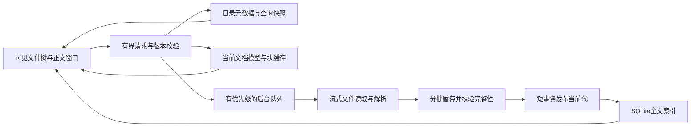

# LLD-CR055-v2：大规模编码与知识库性能方案

> v3实施已授权：用户2026-11-21“执行吧，进行开发”，并选择重建期间持续显示有版本的索引快照、GB单文件先只读窗口/搜索/原件操作。采用关系与独立审查见[执行增量](LLD-CR055-v3-执行授权与快照语义.md)。下文暂停同库全文路线转历史，不实施；其他容量/正确性预算保留，实际软件成绩另报。

- 日期：2026-11-21；负责人：lead；状态：**v2带门禁设计包独立复审通过；未实现、未压测**。
- v2落实：[分Feature工作包与接口/快照/保存契约](LLD-CR055-工作包与接口契约.md)、[目录与索引发布数据设计](../DB/DB-CR055-性能目录与索引发布设计.md)、[测试口径与完成时限门禁](../Test/TEST-CR055-性能基准与故障验收.md)。Story034/036/014已各登记5/6/5条稳定AC草案；技术评审不替代用户产品决定、可操作UI准入或软件性能验证。
- 需求与业务归属：[CR-055](../PRD/CR-055-大规模编码与知识库性能.md)；FEAT-007／008／009分别保留独立实施边界。
- 本次建议：保留现有 CodeMirror 6、React、Tauri/Rust、SQLite FTS5；把每次交互的处理量限制在可见内容、增量修改和有界队列内。先移除全量工作，再补有界资源调度，最后按格式支持GB级原件。
- 非承诺：任意硬件、任意文件格式、无限规模下绝对零延迟。本方案给出待确认的负载与验收预算；后台任务可以耗时，前台操作必须持续响应。

## 1. 需要分别处理的规模

| 场景 | 建议评审基线 | 设计目标 |
| --- | --- | --- |
| C1 大项目 | 500目录、10,000文件、总300万行；额外10万文件压力组 | 打开项目不读取全部正文；目录按需取，展开多时仍仅渲染视口 |
| C2 单大文本 | C2a：100万行、约20～50MiB；C2b：100MiB；C2c：10MiB单长行 | C2a必须验完整编辑；C2b是否完整编辑由G-PRODUCT决定，窗口只读通过不算编辑通过；C2c验证资源边界，完整能力分别报告 |
| K1 大知识库 | 50目录、50,000文件、总10GiB；1万与10万文件作为梯度 | 目录、全文检索与当前阅读不依赖全库原件加载；50,000项不可被旧10,000限额截断 |
| K2 GB级单文件 | 2GiB与5GiB真实分配文本；另有大PDF／压缩Office样本 | 原件流式保管和导出；文本窗口读取；索引后台化；格式能力分别验收 |

“总300万行”与“单文件100万行”，“全库10GiB”与“单文件5GiB”是不同测试，不互相代替。文件数、总字节、行数、最长行、图片像素、PDF页数、Office解压后体积都需记录。单个GB级文档任意编辑是额外重大工作，不应在普通编辑器里强行全量载入。

## 2. 现有实现：可复用部分与明确风险

以下是2026-11-21工作区源码观察。耗时影响是待trace验证的推断，不是已测瓶颈排名。工作区有大量既有未提交变更，不能把Git HEAD等同所读全部源码。

| 位置 | 已确认事实 | 随规模增长的风险／处理方向 |
| --- | --- | --- |
| [编辑更新](../../src/modules/editor/index.tsx#L232-L245) | 每次docChanged执行doc.toString()并与saved字符串比较 | 每键全量字符串化与比较；改为保存检查点／增量脏状态，精确处理撤销到已保存版本 |
| [编辑模型](../../src/modules/editor/index.tsx#L114-L125) | 每Tab保存EditorState与整篇saved字符串；一个活动EditorView | 复用现有模型和视口机制；控制非活动模型、历史与基准副本内存，不每键复制全文 |
| [文件树](../../src/modules/editor/FileTree.tsx#L59-L132) | 已按目录懒加载；patchNode遍历已加载树；展开节点全部DOM渲染 | 保留懒加载，增加虚拟行、按ID实体索引与局部更新；避免全树map |
| [文件读搜](../../src-tauri/src/commands/fs.rs#L101-L181) | 读文件／搜索read_to_string；搜索限制结果数，但无任务取消及分批结果 | 结果限额不限制无命中扫描成本；将I/O移入有界工作队列，流式搜索与主动取消 |
| [知识树](../../src-tauri/src/commands/knowledge.rs#L277-L281) | 持DB全局连接锁遍历库文件并构造全树 | 目录扫描与锁争用；改持久登记＋按parentId分页，I/O不持共享DB锁 |
| [知识读取解析身份](../../src-tauri/src/commands/knowledge.rs#L33-L46) | 非已有Markdown索引项的身份解析可回退全库entries | 多文件点开可能反复扫描；全格式稳定文件登记与直接索引查询 |
| [知识首次检索与扫描](../../src-tauri/src/commands/knowledge.rs#L91-L158) | 初次搜索可内联重建；library_files累计所有可读文本后事务发布 | 总正文内存累计；完整重建与锁等待进入交互链路；改后台流式增量任务 |
| [知识限额](../../src-tauri/src/commands/knowledge_files.rs#L15-L19) | TEXT_LIMIT=1MiB，FILE_LIMIT=25MiB，ENTRY_LIMIT=10,000，DEPTH_LIMIT=32 | 现状不支持目标规模；先改处理方式再分类调整限额，不能只删限制 |
| [数据库连接](../../src-tauri/src/db.rs#L10-L36) | 已启用WAL，但全局Mutex包住一个Connection | WAL不能绕过应用层全局串行锁；解析I/O锁外执行，限时独立读连接＋单写者短事务 |
| [知识Reader](../../src/modules/knowledge/Reader.tsx#L112-L164) | 整树获取；全文Markdown生成；300ms搜索防抖只忽略旧返回 | Promise不等于Worker；解析仍会占主线程；需要任务取消、版本戳和分块产物 |
| [正文与TOC](../../src/modules/knowledge/Reader.tsx#L313-L339) | 从完整HTML再次DOMParser生成目录；正文整篇插DOM；草稿textarea隐藏保活 | 双重DOM／长文布局／输入放大；改块模型、虚拟正文、大纲直接来自解析产物 |
| [阅读会话缓存](../../src/modules/knowledge/knowledgeWorkspace.ts#L21-L40) | 模块级Map保存库会话与已读取的完整文件，没有字节预算或淘汰入口 | 长期切文件后内存增长；建立跨库预算，清洁缓存可淘汰，草稿不能丢 |
| [已有全文索引](../../src-tauri/src/commands/kb_index.rs#L19-L38) | FTS5切片、查询字数／候选数／响应字节有界；单字扫描限1000块／4MiB | 应复用，不另造全库正文扫描；单字召回与incomplete展示必须补齐，不靠截断伪造性能 |

已有知识设计中对短事务、版本化切片、发布指针、源新鲜度的要求继续有效，参见 [知识LLD](LLD-FEAT-008-本地知识索引与按需检索.md) 与 [知识DB](../DB/DB-FEAT-008-知识原件切片与全文索引.md)。这些完整设计尚未全部落地；本轮以源码事实判断，而非把文档写过当已实现。

## 3. 总体结构与资源约束

原则：

1. 前端只订阅当前对象与可见行；滚动不查询全库，不把每个文件或代码行都变成React节点。虚拟化限制DOM数量，分页限制IPC大小，两者缺一不可。
2. 文件打开、输入反馈优先于目录预取；显式搜索优先于后台全库索引。扫描／解析／哈希使用限并发的Rust工作队列，CPU密集计算不直接放async执行器；UI数据处理按小批调度。
3. 队列按**在途字节数**和任务数双重限额；初值后台2个worker、1个DB写者、最多2个读连接，全流水线在途载荷64MiB；全部索引worker合计256MiB计入进程树1GiB总预算。decoder/AST/manifest/terms/SQL/IPC副本和SQLite缓存均须计入，具体预留/释放见[工作包§11](LLD-CR055-工作包与接口契约.md#11-全局资源预算与极端输入)。候选预算未实测。
4. 取消必须传到生产者；前端忽略旧结果不算真正取消。分页、搜索、解析、读取均带requestId、对象ID和revision；无观察者时取消预取，不取消用户明确发起的需持续后台导入，关闭页签不终止项目AI会话。
5. 缓存按字节计：阅读／预览128MiB起、代码非活动清洁模型128MiB起；活动缓冲单独计入总预算，单个超额对象不强行入清洁缓存。未保存草稿、撤销和恢复记录不能LRU静默删除；需要卸载时先有可靠恢复快照并验恢复，压力过大明确暂停新载入。
6. 不预设引入分布式数据库／消息系统／向量库。SQLite不够用须有锁等待、查询计划、索引体积证据后才评审引擎替换。

## 4. 编码区方案

### 4.1 文件树

- 保留现有按层读取，后端提供有界目录页，前端维护`nodeId → metadata`及`parentId → childIds`。展开、重命名、状态更新只改相关实体；可见序列只在结构变更时调整。
- 虚拟列表只挂可见行＋上下少量预取；大同级目录也分页。候选单页200项／响应≤256KiB，超长名称仍由实际字节限额控制。
- **分页不能是假优化**：若每页都read_dir整目录再sort后slice，首开仍O(n)。已盘点目录从索引按稳定排序键分页；未盘点目录后台扫描建快照，先返回加载状态。稳定字母序的冷目录首屏可能须等一层枚举完成，这段真实成本单列，不承诺未知文件系统下常数时间。
- 游标绑定目录版本、排序、过滤与根；文件增删使游标过期时保留选中／滚动锚点后刷新，不遗漏／重复。无需精确总数时显示已加载量，不为计数抢跑全库。
- 文件系统watch事件合并；风暴、溢出或恢复后后台对账，不把事件流当绝对可靠，不能每个事件都整棵树重建。

### 4.2 文档编辑

- **首选继续用CodeMirror 6**。利用其持久文本树与视口渲染；先移除外层每键`toString()`，不自行重写文本引擎。
- 保存检查点保存文档版本／不可变文档引用；交易增量立即标脏，撤销到保存检查点可准确清脏。任意手工改回相同文本不能仅靠version差值判断；采用结构共享比较或后台分块精确确认，不能用哈希碰撞结果直接清除未保存标记。
- 文档state、选区、撤销、滚动与Tab身份分离。切页签不重建活动view；语言扩展仅在类型／档位改变时重配；隐藏页停止装饰、解析结果渲染与无用订阅，保留草稿。
- 打开前先取size／类型／编码信息。常规文件完整模型；大文本仍保持本地编辑，按成本减少非必须的全篇高亮、折叠、自动链接、格式化等；检查超长行，不只看字节阈值。建议起始档位≤5MiB正常、5～50MiB大文本、>50MiB经容量判断转窗口模式；均待基线调整，不是已确认产品限制。
- 读取走分块传输，避免一个巨大JSON字符串；但**分块传输不等于内存有界**，完整CodeMirror模型仍需容纳全文，必须独立测模型初始化／高亮／历史峰值。
- 保存按文件串行，明确baseRevision、docRevision、requestId；只确认已提交版本，后续输入仍脏。小文件可一次保存，大文件分段写临时文件、校验外部变更、刷新并原子替换；导入／保存失败保原件和草稿。自动保存策略按CR-048整合，不在本次反向取消。

### 4.3 项目搜索

采用成熟Rust搜索库（`ignore`／`grep-searcher`等候选）或受管搜索子进程，避免自写逐文件整篇读入循环。最终依赖固定版本、许可及打包成本在实施前确认。

- .gitignore、显式排除规则与用户选定范围可解释；不因为速度静默漏文件。现有白名单／深度限制属于搜索语义，变更先登记。
- 分批结果、最大结果数、字节上限、时间片和取消；显示已搜索范围／截断／进行中。无匹配、大量匹配、超长行、中文与编码混合都测。
- 优先保现有字面量语义，不借优化新增任意复杂正则或自动运行外部预处理器。全文扫描首次总耗时允许随字节增加，但不占UI线程。

## 5. 知识库方案

### 5.1 文件登记与按需目录

以现有候选`kb_file / kb_revision / kb_generation`模型为基础补齐全格式文件身份，不另建第二授权源。目录索引需`libraryId,parentId,sortKey,fileId`组合访问路径，覆盖分页／直接定位；新增parentId等候选字段须在对应DB设计修订后迁移。

打开库只读根页和当前文件元信息，不调用全库`entries`；后续目录展开按层分页。所有者操作立即更新相应目录，监听增量补偿；绑定目录离线是unknown／offline，不能被识别为空目录后批量删除索引。noteCount的现有Markdown语义不悄改为所有文件数，新增统计分别命名。

### 5.2 流式增量索引

`盘点元信息 → 判定变化 → 流式哈希/解析 → 有界切片 → 分批暂存 → 校验 → 发布 → 清理旧代`。

- 首次建立索引改为后台任务，首次搜索不等待全库重建；已有有效索引继续可查，未就绪部分显示覆盖状态。源已变或新鲜度未知的片段按现行规则阻止作为最新AI输入，不把旧索引直接标新鲜。
- stat仅用于候选变化检测，不替代内容校验；沿用sourceHash＋parserVersion＋chunkerVersion＋tokenizerVersion。对无变化文件不重解析；新增／修改／删除／移动只处理受影响项，身份不凭内容相同就合并。
- 每次只持有限块，不先把所有正文放入`library_files`。流式切片维护UTF-8／CRLF／代码围栏／表格边界；极长行或超大表格可拆但必须保留准确位置与连续覆盖。
- 解析和哈希不持DB连接全局锁；一写者批量提交，读取短快照，避免长读事务导致WAL无法checkpoint。只是启用WAL不解决锁竞争，现状已经启用。
- 选定候选双路径：受影响旧删除＋新插入≤64chunk且≤256KiB索引载荷的小更新沿原单事务；超限走同一SQLite中的独立完整库代影子FTS，后台分批构建、校验后CAS切activeGeneration。变化文件才重解析，但影子FTS写入量为O(全库当前索引)，不能称O(变化量)。物理身份、并发更新串行化、baseEpoch/fence、快照租约、崩溃恢复与GC见[数据设计§2](../DB/DB-CR055-性能目录与索引发布设计.md#2-选定的索引物理路线)。
- 若GB旧源变化/删除，候选采用G-SEARCH：该库全文检索显式rebuild_pending直到新代就绪，其它库/该库目录与原件阅读保持可用；这是未获用户确认的可用性取舍，不能视为无行为变化的优化。需同时保证同库持续可搜与严格当前BM25时必须换更复杂排名/分段设计后重审，当前路线不得实施。
- 删除／取消／重试有fence与attempt，只当前任务能发布，取消后迟到结果不得复活。新增坏文件不影响未失效的active代；已有大文件失效可能触发上述同库检索暂停，明确区分，不能笼统宣称所有故障都不影响其它文件。
- 当前中文单字受限扫描不能承诺完整召回。保留incomplete并明确覆盖；若确认全库中文单字检索，优先版本化词项／单字倒排方案，并测索引膨胀，不能去掉护栏直接扫全部切片。
- 检索返回范围／游标／摘要有界；AI授权在返回前复检，缓存键含库、文件修订、解析代及授权epoch，不因缓存命中跳过撤权检查。

### 5.3 阅读与编辑

- 列表与正文均按需渲染。普通Markdown采用块级解析产物，目录由同一解析结果生成，不从完整HTML再建第二套DOM。
- Markdown边界不能随便按字节裁切后独立解析：参考链接、列表、表格、围栏、重复标题ID与脚注需文档级结构上下文，后台解析生成稳定blockId／outline与源范围，再按视口取块。
- 大纲定位到尚未渲染块时先载入并定位；保留滚动锚点。全文查找、全选、跨块复制和导出不能只覆盖已挂载DOM，必须从模型／后端读取，搜索结果可定位未渲染部分。
- 排版内编辑遵守CR-048；活动编辑块及IME合成期间不能虚拟卸载。大文档编辑引擎与块模型互通须单独验证，不能用只读虚拟展示冒充可编辑能力。
- Worker用于纯文本解析等计算；DOMPurify与DOM相关处理在可行线程上按块有界执行，不能默认DOM API可直接搬到Web Worker。Promise、lazy import和content-visibility可辅助，但不能替代分块／虚拟化／缓存预算。
- 图片使用受限原件访问／缩略图，避免把大图Base64同时留在Rust、IPC、JS与DOM；限制解码像素和并发。清洁阅读缓存可淘汰，草稿和未同步编辑不丢。

### 5.4 GB级文件按能力分层

| 文件／操作 | 推荐首期 | 限制与代价 |
| --- | --- | --- |
| 任意已允许格式原件导入／导出 | Rust流式复制，进度、取消、磁盘空间检查、校验和、临时文件清理／恢复 | 完整耗时取决于字节与磁盘；不经Base64或整包JSON，不自动扩展格式执行权限 |
| 大TXT／LOG／CSV／JSON | 窗口读取、稀疏行索引、后台搜索；CSV先安全文本，JSON不全量parse | 第一次随机行跳转可能需建立行索引；显示定位进度，不伪造即时跳转 |
| 大Markdown | 源码窗口阅读可先提供；结构化阅读在块索引就绪后渐进显示 | 只读降档须用户确认；不能称全篇排版编辑已支持 |
| 大PDF | 作为逐格式后续工作包评审范围读取和按页渲染 | 当前无查看器，需解析／沙箱／像素缓存边界；随机访问结构可能影响首屏 |
| 大DOCX／XLSX／PPTX | 首先完整原件保管，后续受限解析到章节／行块／页单元 | ZIP中央目录、解压体积／比例、共享字符串、公式与嵌入对象需限额；不承诺任意5GiB原件完整编辑 |
| GB级文本任意编辑 | 单独评审后端磁盘piece-table／分段文档及增量日志 | 跨块选区、撤销、查找替换、保存与崩溃恢复工作量大；普通内存rope不能自动保证磁盘级有界内存 |

## 6. 拟议接口、兼容与数据恢复

以下是契约草案，尚未创建命令：

| 接口 | 输入重点 | 输出及失败规则 |
| --- | --- | --- |
| list_children | scopeId,parentId,cursor,limit,requestId | items,nextCursor,directoryRevision；双重条数／字节限额，游标过期显式返回 |
| open_document | scopeId,fileId,expectedRevision,requestId | metadata,mode,capabilities,初始块；超额不得直接全文读入 |
| read_window | docId,revision,起始行或字节,maxBytes,requestId | 字符边界内块、源范围、eof；编码不支持／版本变化显式失败 |
| search_start / cancel | scopeId,query,requestId,预算 | 有序结果批次、done/incomplete/cancelled，取消传到扫描生产者 |
| index_start / status / cancel | libraryId,scope,attemptId | 真实阶段、已处理文件／字节、错误和覆盖，不将未完成显示ready |
| save_document | docId,baseRevision,docRevision,requestId,内容或增量流 | 已提交版本；同文件串行、外改冲突保草稿、后续输入不误清脏 |

沿用后端根路径边界、受检文件身份及原件冲突校验。新API与旧API通过小范围兼容适配并行，业务页面逐个切换；大文件不能走旧全文回退而导致再次卡死。

迁移先备份一致性SQLite快照、原件与身份映射；不覆盖现有授权、会话、历史引用。构建新派生索引后抽样／全量范围校验，再切当前代。回退停新worker和新入口，保留新产生的原件及草稿；不得恢复旧DB覆盖新业务数据，不依靠删除数据“回退”。存量旧ID保持可追溯映射，未识别冲突拒绝发布。

源freshness与性能存在明确取舍：完整5GiB哈希会耗时。按现行严格设计需复核的操作应异步等待并保持UI响应；stat缓存不得默默代替完整哈希。如欲信任受管不可变副本以减少重复校验，必须先修改已确认的新鲜度策略并另行评审。

## 7. 候选验收矩阵与采样方法

下表均是**建议预算**，没有任何一项已有本轮实测结果。候选机器：Windows 11 x64、4核8线程、16GiB RAM、NVMe、60Hz，release构建，固定CPU型号／电源模式／WebView2版本后方可对比。8GiB、机械盘、网络盘单独报告；本地SQLite WAL不放网络文件系统。

| 编号 | 测量场景 | 候选通过线 |
| --- | --- | --- |
| PERF-055-01 | C1项目／K1知识库首次进入，到目录首屏可操作 | 冷启动P95≤2s；应用已启动的暖切换P95≤500ms；不等全文索引 |
| PERF-055-02 | 已盘点目录展开、选择 | 缓存P95≤100ms，冷读页P95≤300ms；未盘点巨大同级目录单列真实枚举时间 |
| PERF-055-03 | 普通代码连续输入／中文IME／删除／撤销到下一可见帧 | P95≤32ms、P99≤100ms；C2大文本P95≤50ms；≥200ms应用主线程停顿判失败并定位 |
| PERF-055-04 | C1/K1连续滚动、拖栏与树键盘定位 | 60Hz下帧间隔P95≤20ms、丢帧≤2%；记录最大帧间隔与布局耗时 |
| PERF-055-05 | 已加载且未淘汰代码Tab切换／阅读缓存切换 | P95≤100ms；冷模型恢复另报≤1s候选，不能混入暖数据掩盖 |
| PERF-055-06 | C2a完整模型首屏／K2受保护直接读取首窗口 | P95≤2s候选；若需全量复制/转码建立快照，则完整准备从原请求计入S-READY吞吐门禁；loading不算成功，随机行索引按S-LINE，不无条件承诺2s |
| PERF-055-07 | 分开测纯DB候选、所有者结果、防抖端到端与已核验AI正文 | S-DB暖P95≤300ms/P99≤1s、冷P95≤1s；S-OWNER暖P95≤500ms；S-TYPE含300ms防抖暖P95≤800ms；S-AI含完整源SHA按H-min门禁，不能宣称GB正文300ms |
| PERF-055-08 | C1项目全文搜索 | 有前部命中首批P95≤500ms；无命中完成时间与吞吐另报，必须可取消 |
| PERF-055-09 | 索引／导入／搜索并行时操作与取消 | 输入反馈仍满足03；取消UI反馈≤100ms，worker停止生产P95≤250ms（阻塞系统调用／格式解析器例外单列，不静默通过） |
| PERF-055-10 | 测试设计M1常规/M2大编辑/M3 GB窗口并发工作集持续30分钟 | 应用自身全部进程树私有内存候选≤1GiB，包含全部索引worker合计≤256MiB；外部AI CLI另报；活动模型/脏草稿/历史/副本均计入，M4百MiB编辑待产品决策后独立验收 |
| PERF-055-11 | 清洁文件打开／关闭100轮，回相同稳态 | GC／缓存稳定后净增长≤50MiB，DOM／监听器不线性增长；未保存草稿量保持相同 |
| PERF-055-12 | 10,000→50,000→100,000文件及1→10GiB增长 | 稳态树DOM≤可见行＋overscan；打开单个小文档的正文读取量不随全库总量增长；队列峰值守预算 |
| PERF-055-13 | 保存、读取、索引、取消、崩溃／磁盘满／外改／撤权 | 零已确认保存的数据丢失、无错版本正文、无越权缓存、无漏文件伪完整；性能通过不得豁免正确性 |

测量协议：

完整索引、无命中搜索、首次行索引、原件导入导出、耐久保存和绑定源完整SHA按[测试设计§3](../Test/TEST-CR055-性能基准与故障验收.md#3-完整耗时门禁g-throughput)冻结H/C/N/L/I-min及绝对deadline；各Feature负责人先测基线、用户确认，再用独立保留样本验收。未冻结/未达标不能结案；“另报”不再代表无限期无完成门槛。

- 各组记录总量、类型分布、最长行、层级、UTF-8／UTF-16／中文与emoji、压缩率，夹具固定seed与清单hash；基准数据与生产资料隔离。C1普通文件与C2单大文件分开，K1拆“全可索引文本10GiB”和“含二进制10GiB”，避免大量不可解析附件让索引成绩虚快。
- 每组至少5个独立会话；暖交互每组≥1000次，分别报告P50/P95/P99/max与样本数；打开／冷缓存类初筛≥30次，最终P95至少100次，少量冷启动不伪报可靠P99。不将各轮中位数当成全样本P99。
- 区分应用缓存冷、OS文件缓存冷、索引已建／未建。无法清OS缓存即标OS暖，不用“重启页面”冒充冷磁盘。
- 输入计时从事件到展示变化的帧；同时记录WebView trace、Long Task／可用LoAF、React提交、JS堆、Rust/进程树私有内存、IPC字节、DB锁等待、WAL大小、I/O吞吐。只用JS handler耗时不能证明屏幕已显示。
- 参考产品使用同机器、同数据、同操作、相同功能档位并固定版本。共有场景建议本项目P95不高于参考值1.2倍且仍过绝对预算；参考不支持的5GiB或格式单独验收，不编造对标值。降高亮模式与完整高亮模式不能混比。
- 每轮包括后台全库首次索引、文件变更风暴、窗口隐藏后恢复、重复切换、大量搜索命中、无命中、超长行、损坏Office／PDF、磁盘不足和外部改写。不得以减少数据集或放宽阈值抹掉回归。
- CI先固定小型性能夹具和统计回归；大数据／桌面同机基准定期运行。建议持续两轮同条件退化>20%进入调查，绝对门槛失败立即阻止“已达标”结论；波动阈值先定后测。

## 8. 实施顺序、收益与可交付边界

| 阶段 | 工作内容 | 交付与退出条件 | 风险／成本级别 |
| --- | --- | --- | --- |
| P0 设计与测量基线 | 明确本CR五项决策与对应门禁、固定数据集和硬件，补大文件／索引进度UI，获得对应编码授权后建立trace基线 | 原始基准、热点排序、UI版本与每Feature AC映射；本轮不执行 | 小～中；不能跳过 |
| P1 编码热路径 | 消除每键全文比较，虚拟文件树，搜索后台化和取消，模型预算 | C1日常输入／树／搜索达到预算，草稿／撤销／保存回归通过 | 中；优先收益高 |
| P2 大知识库数据链路 | 文件登记／分页，后台增量流水线，锁外I/O，读写连接与版本发布，清洁缓存淘汰 | K1目录／检索／并发索引下响应达标，数据与权限正确 | 中～大；迁移与索引发布最关键 |
| P3 大文档与GB原件 | 文本窗口、行索引、块阅读、流式导入导出；PDF／Office逐格式评审 | C2/K2分能力验收；完整编辑未通过就明确仍不支持 | 大；大文件任意编辑额外一档 |
| P4 回归固化 | 长时运行、规模梯度、故障、同机对照与CI预算 | 可复核报告、阈值、回退演练、用户验收 | 持续门槛；不以体感结案 |

P2可在P1接口明确后独立推进；每个执行上下文只能实现一个Feature。共享组件由对应执行包明确owner，不借“公共优化”扩权。当前没有按人天估算：热点实测、格式选型和GB级编辑边界未确认时，给固定天数不可靠。

备选比较：

- A：只做React memo、样式／防抖和提限额。改动小，但无法解决整库正文累计、全局锁、整篇HTML与GB级IPC，不能覆盖目标，不推荐。
- B：本方案，保留现有底座、改数据流与资源边界。建议采用，按三个业务Feature分包落地。
- C：直接更换编辑器、搜索引擎和存储底座。迁移面大，当前证据不足以证明收益；只有B路线实测出现不可解决瓶颈再评审。

## 9. UI与数据设计前置义务

本轮只有架构与状态清单，**没有制作新的可操作UI稿，不能据此放行界面开发**。后续在[唯一设计入口](../UI/仿真原型UI.html)补以下场景：目录加载／部分加载／错误重试，大文件正常／受限／只读／恢复，索引排队／进行中／取消／失败／部分覆盖，虚拟正文定位／搜索／复制，保存冲突／缓存卸载恢复，窄屏和深浅主题。

继承 [UI-CR049-v1](../UI/文档/UI-CR049-滚动条按需显示.md) 的 **UI-SCROLL-001**，本轮所读规范SHA-256为`a7cfe6449d07a76b0c83c9f3c6db280a3f42eb4afe00deb4d3882af7ea3fbd7c`。适用编码树／编辑正文、知识树／阅读块／正文目录和结果浮层；实际滚动显示、停止700ms隐藏、悬停不唤醒、嵌套隔离、宽度不跳、IME／草稿／选区／撤销保持。虚拟化不准用overflow:hidden禁用滚动，不准用重挂载清状态。原生PDF等独立上下文需单列限制和动态证据。

DB并非不适用：FEAT-008须补稳定文件登记、parentId分页索引、任务恢复／代际发布的数据设计；FEAT-007文档卸载恢复与大文件增量日志如启用也需数据设计。当前只给候选契约，不运行DDL、不改真实库。未来开放并发连接前确认SQLite实际构建版本包含官方WAL并发修复及其回归，不能仅按Rust包装库版本判断；依据[SQLite WAL官方说明](https://sqlite.org/wal.html)。

## 10. 本轮核验与交接

- 仓库HEAD：`5b18af6cddaac958f87470c0e18e59288acf7f8e`；分支main；存在大量既有未提交源码／设计／文档。以上证据来自所读工作区，不声称与HEAD完全一致；实施前需重新冻结受影响源码hash。
- 已做：只读源码链路审查、现有Story归属核对、本地参考实现与基准定义核验、官方文章阅读；没有读取真实知识库或私密会话。
- 参考机制：虚拟树＋懒加载；持久文档树和增量变化；多缓冲文本结构避免每次大字符串转换；成熟Rust流式搜索；WAL并发与checkpoint的限制。已有同构参考中的“大文本输入”夹具实际约2万行／700KB，不能外推百万行或GB文件。
- 官方依赖证据：[CodeMirror百万行示例](https://codemirror.net/examples/million/)明确展示百万行与限制解析工作量；是能力线索，不是本应用通过证明。
- 论文核验边界：[Ropes: An alternative to strings](https://doi.org/10.1002/spe.4380251203)（Boehm／Atkinson／Plass，1995）题录及摘要已核对，支持分段文本结构方向；[SEDA](https://doi.org/10.1145/502034.502057)（Welsh／Culler／Brewer，2001）本轮只核对题录，分阶段队列／背压是方案候选启发，不声称已全文复现；[The Tail at Scale](https://doi.org/10.1145/2408776.2408794)（Dean／Barroso，2013）题录与摘要已核对，借鉴尾延迟观测，不照搬分布式重复请求到本地文件写入。三项均未进行论文实验复现。
- 工具限制：检索服务返回余额不足，改直接读取官方URL与Crossref；部分论文站点403／404，未将失败页面当全文证据。UI技能已加载路由并查询performance类别，选定组件性能指引但正文获取fetch failed；本方案依据项目源码与明确来源完成，不声称已应用未读正文。只读CLI委派启动失败，无代理结论纳入证据。
- 验证结果：两份新增文档的29条本地链接／源码行范围检查通过、未发现尾部空白；5份关联既有文档的`git diff --check`通过（仅Git LF→CRLF提示）。已核对本轮均为文档定点增补，Git diff还包含其他既有改动，不将其归为本次产出。**软件测试、构建、性能基准、参考产品运行、视觉对照均未执行**。
- 恢复检查点：CR-055-v2；本轮已形成16条AC草案、分Feature工作包、DB/接口/快照/保存协议和测试口径；下一步确认现有AC草案及D-055-01～05、补可操作UI稿、冻结设计版本与基准参数。对应门禁及明确编码授权满足后，才在各自Feature执行上下文实施；当前软件测试均未执行。
