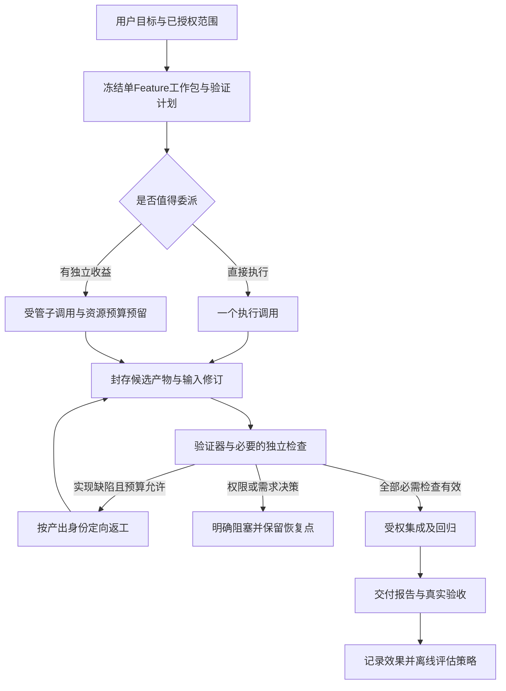

# RESEARCH-004：任务派发、子智能体调度与交付闭环研究

- 日期：2026-11-21；类型：只读调研＋设计建议；负责人：lead。
- 用户诉求：参考 t3code、同类开源项目及论文，判断现有任务派发／子智能体调度的优化方向，能否形成闭环和实际交付能力。
- 授权边界：本次仅调研、方案和文档核验；未改正式源码、运行配置、依赖或构建产物，未运行真实模型任务、软件测试或性能实验。
- 项目基线：NestCraft，`main`，HEAD `5b18af6cddaac958f87470c0e18e59288acf7f8e` 加当前未提交工作区；存在大量并行修改，源码结论是本次读取快照，不能当作发布版保证。当前使用的 DSH 宿主工具不属于本产品的已实现能力。
- 关联既有范围：[FEAT-018](../Plan/Feature/FEAT-018-需求派发与项目任务追踪.md)、[FEAT-019](../Plan/Feature/FEAT-019-依赖调度与受管执行.md)、[FEAT-020](../Plan/Feature/FEAT-020-自动验证与结果交付.md)、[STORY-022](../Plan/Story/STORY-022-按需子智能体与用量统计.md)。本研究不新建业务层级，不修改既有 AC、确认或验收状态。
- 持续有效的本项目建议归入[依赖调度方案第9节](../LLD/LLD-FEAT-019-依赖调度与受管执行.md#9-2026-11-21调研后的实施优先级与效果验证建议)。本报告保存外部来源、审计证据与推论边界，不替代 PRD。

## 1. 判断

能形成闭环，但首要工作是落地已经设计过的执行与验证主链。当前产品有 CLI 会话桥、普通会话原生续接、单 Feature 身份绑定及展示组件；受管 runner、业务任务账本、子任务结果消费、验证和交付链尚未接通。继续扩展 CLI 数量或子代理按钮，不足以改善最终交付能力。

建议以三层闭环衡量进展：

1. **执行闭环**：任务被持久接纳、只执行允许的工作，能停止、能判断是否可恢复，失败不会变成无限等待或重复副作用。
2. **质量闭环**：提交的是候选产物；按冻结验收标准验证，失败回到产出者有限返工，新修订重新验证，最终交付证据可审阅。
3. **改进闭环**：记录任务类型、实际组合、耗时、失败原因、返工和人工介入；在固定任务集上比较策略，只有效果证据支持才调整路由与并发。

现有 CR-026／031／037／047 已覆盖前两层的大量设计。新增价值主要是明确落地顺序、识别实际代码断点、补充效果评估和委派收益决策。不能把再写一套更大的编排框架当成落地进展。

## 2. 本项目事实与差距

“未实现”以下均限于已审查代码、接口注册与现行文档，不声称排除了所有外部插件。代码位置随并行修改可能变化。

| 环节 | 读取到的实际事实 | 对闭环的影响／复用点 |
| --- | --- | --- |
| 派发入口与任务页 | [Workspace.tsx](../../src/modules/projects/Workspace.tsx#L239-L259)只设置执行 Feature 并创建会话；[任务页](../../src/modules/projects/Workspace.tsx#L495-L516)明确 runner API 未接入 | 当前“派发”尚不是持久 Task 的接纳、领取和执行；可复用项目／Feature选择及页面 |
| CLI适配 | [dispatch.rs](../../src-tauri/src/commands/dispatch.rs#L168-L334)解析供应商、协议、密钥引用、配置；[chat.rs](../../src-tauri/src/commands/chat.rs#L971-L1114)启动CLI | 可作为 adapter 基础；不能把配置注入模块当调度器 |
| 原生续接 | [稳定profile](../../src-tauri/src/commands/dispatch.rs#L154-L165)、[绑定判断](../../src-tauri/src/commands/chat_binding.rs#L151-L258)、[CAS结算](../../src-tauri/src/commands/chat_binding.rs#L369-L449)已经存在 | 普通会话有实质基础；不等于持久任务恢复、产物返工或副作用对账 |
| Feature范围 | [创建校验](../../src-tauri/src/commands/chat.rs#L92-L110)、[发送复检](../../src-tauri/src/commands/chat.rs#L358-L368)已有身份约束 | 发送比较索引hash，未在此路径重新读源；尚无完整Story／AC／UI／LLD／DB工作包指纹与写范围控制 |
| 子代理展示 | [ChatPanel事件处理](../../src/modules/chat/ChatPanel.tsx#L420-L445)、[运行状态Map](../../src/modules/chat/sessionRuntime.ts#L41-L83)和[演示种子](../../src/modules/chat/sessionRuntime.ts#L218-L239)存在 | 展示不证明真实子代理通道已接通；所审后端解析未找到对应完整派发链 |
| 发送防并发 | [RUNNING](../../src-tauri/src/commands/chat.rs#L18-L59)按session互斥，并有turn身份防迟到清理 | 进程内互斥可复用；不是跨重启的requestId幂等、领取租约、activeKey、资源锁 |
| 停止 | [abort入口](../../src-tauri/src/commands/chat.rs#L317-L321)、[kill_on_drop](../../src-tauri/src/commands/chat.rs#L1109-L1114)、[停止执行](../../src-tauri/src/commands/chat.rs#L1190-L1238) | 直接子进程kill不证明整树无writer；尚不能据此安全释放资源并重启替代writer |
| 日志与恢复 | [流失败处理](../../src-tauri/src/commands/chat.rs#L1235-L1269)、[归档写入](../../src-tauri/src/commands/chat.rs#L1473-L1496)主要在结束后入库 | 超时／非零退出路径未携带完整已收集outcome，存在部分输出丢失风险；按消息类型分组存储不保留原始交错顺序 |
| 审批 | [chat_approve_tool](../../src-tauri/src/commands/chat.rs#L324-L327)显式返回暂无待审请求 | CLI权限参数不能替代FinalCall绑定、审批一次消费与撤权复检 |
| 结果与验收 | [done结果](../../src-tauri/src/commands/chat.rs#L644-L694)主要描述原生绑定结果；[验证交付方案](../LLD/LLD-FEAT-020-自动验证与交付.md)仍是设计 | 需要候选产物、输入修订、冻结ValidationPlan、证据失效、集成回归、交付报告 |

### 2.1 应先复现的接口交叉问题

**F-004-01：执行会话第二轮可能卡在无法确认的fresh状态（静态推导，未运行复现）。**

[chat_send](../../src-tauri/src/commands/chat.rs#L402-L450)对所有会话执行原生绑定解析；[load_binding](../../src-tauri/src/commands/chat_binding.rs#L112-L137)仅加载ordinary，executor得到空快照；[resolve_binding](../../src-tauri/src/commands/chat_binding.rs#L186-L193)遇有历史且无引用返回FreshPending；[confirm_fresh](../../src-tauri/src/commands/chat_binding.rs#L514-L520)又拒绝executor。应首先验证执行会话连续两次发送，以及普通会话续接是否保持。修复应按原责任Feature另行授权，不能借研究直接改代码。

**F-004-02：源版本检查可能读到旧索引（静态风险，未运行复现）。**

发送检查基于`requirement_index.contentHash`；[read_requirements](../../src-tauri/src/commands/projects.rs#L259-L286)负责刷新索引。需要验证“外部修改Feature但未打开需求页→发送”这一反例。长期工作包在接纳／启动／恢复时核对受管源版本；仅缓存hash一致不足以证明源文件未变化。

**F-004-03：现行导航与部分旧设计说明存在时间差。**

[导航CR-047](../README.md#cr-047单特性执行会话侧已实现其余待续)记录Feature身份已实现，而[FEAT-019原CR-047段](../Plan/Feature/FEAT-019-依赖调度与受管执行.md#cr-047单feature执行与恢复)仍含“session无featureId”的旧描述；[协作方案§5.2](../LLD/LLD-CR037-主代理协作契约.md#52-普通侧栏与受管入口)也保留普通续接实现前的接点说明。本研究以实际代码区分范围，不覆盖正在并行维护的历史记录。文档一致性后续由各责任Feature收敛。

## 3. t3code：具体值得借鉴的机制

固定版本为[2c42752892e9d64b34b5819e72e42894710b21b9](https://github.com/pingdotgg/t3code/tree/2c42752892e9d64b34b5819e72e42894710b21b9)，提交时间2026-11-21；研究使用此版本，而非早期“只有GUI壳”的印象。它当前自述为coding agents的control plane，具备多执行器、工作区、委派和持久编排。规模／star数不作为工程正确性或效果证明。

### 3.1 接纳、状态、执行副作用分离

[架构说明](https://github.com/pingdotgg/t3code/blob/2c42752892e9d64b34b5819e72e42894710b21b9/docs/internals/overview.md)和[EventSink](https://github.com/pingdotgg/t3code/blob/2c42752892e9d64b34b5819e72e42894710b21b9/apps/server/src/orchestration-v2/EventSink.ts)表明：命令产生事件，事件、投影、command receipt和effect outbox在同一事务提交，再执行副作用和发布通知；`commitCommand`先`insertIfAbsent`去重，重复请求返回已存结果。

对我们：接纳回执、已执行、验证通过、业务验收必须分开；配置和目标先冻结，持久接纳成功才允许启动。网络／文件I/O不放进数据库事务，副作用跨介质不能承诺通用exactly-once。

**重要差异**：它的事件保留窗口有限，架构明确指出裁剪后不能从事件重建全部投影。我们不能直接声称“采用事件机制即可随时全量回放”；任务授权、审批、effects、产物和验收证据需按本项目保留契约维护。

### 3.2 子任务以父身份、回执和独立工作区创建

[OrchestratorMcpService](https://github.com/pingdotgg/t3code/blob/2c42752892e9d64b34b5819e72e42894710b21b9/apps/server/src/mcp/OrchestratorMcpService.ts#L2825-L2989)实际检查活动父Run及所属provider实例，限制本地任务在父项目，使用稳定commandId／receipt，支持从父HEAD准备worktree；wait和async使用不同的完成唤醒方式。

[工具契约](https://github.com/pingdotgg/t3code/blob/2c42752892e9d64b34b5819e72e42894710b21b9/apps/server/src/mcp/toolkits/orchestrator/tools.ts#L89-L129)明确子任务默认只接收task，不继承父历史；`workState`区分working、waiting_for_children、result_available，停止涉及后续轮次和后代。

对我们：工作包必须自包含且有限，保存父子身份、源版本、交付契约；默认独立上下文，确需继承时使用显式且有界的交接。worktree隔离Git修改，但不是OS文件／网络权限沙箱。项目作用域还需进一步收紧到本项目的Feature授权和文件边界。

### 3.3 子完成不靠父模型记住回收

[Orchestrator完成投递逻辑](https://github.com/pingdotgg/t3code/blob/2c42752892e9d64b34b5819e72e42894710b21b9/apps/server/src/orchestration-v2/Orchestrator.ts#L14623-L14785)持久区分pending／claimed／acknowledged／delivered／disposed，给投递分配generation，并把多个子结果合入尚未执行的唤醒；已停止、归档、删除的父不被迟到结果复活。

[DelegatedTaskQuestionReactor](https://github.com/pingdotgg/t3code/blob/2c42752892e9d64b34b5819e72e42894710b21b9/apps/server/src/orchestration-v2/DelegatedTaskQuestionReactor.ts#L177-L260)依据持久问题状态唤醒父，并按父身份串行处理该父相关反应，避免某个忙父阻塞全部任务。

[完成投递测试](https://github.com/pingdotgg/t3code/blob/2c42752892e9d64b34b5819e72e42894710b21b9/apps/server/src/orchestration-v2/DelegatedCompletionDelivery.test.ts#L333-L420)包含中断完成唤醒后清理两组投递的反例。本次仅阅读测试，没有执行或宣称它们通过。

对我们：沿CR-031的内部child receipt和外部UI outbox分离，把“子结果已存”“父已消费”“本次成果已验证”分别记录。子结束后由运行时投递，不靠对话提醒或轮询；父忙时合并通知，停根后只归档。

### 3.4 上下文和恢复要承认不确定性

[ContextHandoffDelivery](https://github.com/pingdotgg/t3code/blob/2c42752892e9d64b34b5819e72e42894710b21b9/apps/server/src/orchestration-v2/ContextHandoffDelivery.ts)按budget选择历史、记录省略项与补读方式，在注入前后保存pending／injected／inline；发现同一原生线程存在未决注入时返回不确定错误，不盲目重复注入。

对我们：工作包中必需义务不能被摘要删掉；大的代码和历史按引用读取。原生resume、fresh上下文重建、基于检查点的业务恢复是不同动作，不能用一个“继续”按钮掩盖。

### 3.5 适配能力比CLI品牌更可靠

[Provider约束](https://github.com/pingdotgg/t3code/blob/2c42752892e9d64b34b5819e72e42894710b21b9/docs/internals/providers.md)详细区分driver、账号instance、原生问题的live／message响应、会话回退能力、配置所有权和版本差异。

对我们：路由依据应是经过核验的`CLI版本＋adapter版本＋平台＋运行模式＋模型＋所需能力`；“某CLI擅长编码”只适合作为初始偏好。默认路由、最低难度是准入约束，不是成功率证明。引擎切换必须沿现有授权策略，禁止失败时静默扩大权限或换组合。

**不直接采用**：它的多端、远程环境、账号体系和技术栈并非本次必要范围；不为参考而重写Rust／Tauri／SQLite。也不能从以上源码推出它已经具备我们要求的Feature／AC级业务验收、严格预算硬上限或完整产物依赖DAG。

## 4. 同类工程与论文证据

### 4.1 同类工程：持久恢复与受限协作

| 一手资料 | 实际可借鉴机制 | 边界与本项目处理 |
| --- | --- | --- |
| LangGraph：[Checkpointers](https://docs.langchain.com/oss/python/langgraph/checkpointers)、[Fault tolerance](https://docs.langchain.com/oss/python/langgraph/fault-tolerance) | thread_id关联持久状态；super-step检查点与pending writes可保留并行节点成功结果；区分sync／async／exit持久化；重试从节点开头执行，采用至少一次语义 | 检查点不提供外部副作用exactly-once；幂等键须先持久并由外部目标识别，结果未知先对账。借机制，不为此在Rust运行时引入第二套Python编排系统 |
| OpenHands：[Task Tool Set](https://docs.openhands.dev/sdk/guides/task-tool-set)、[Persistence](https://docs.openhands.dev/sdk/guides/convo-persistence)、[Dynamic Agent Workflows](https://docs.openhands.dev/sdk/guides/agent-dynamic-workflow) | 父调用创建或恢复子会话、返回task_id／状态／结果；调用同步等待，并发由父工具并发配置限制；状态与追加事件分别持久化 | completed只是调用结束；提示词“只读”不是沙箱，归并结果不等于集成通过。借子会话稳定身份、有限并发和事件记录，仍按本项目AC验证 |
| 本项目此前的[执行闭环研究](RESEARCH-001-Multica执行闭环与差异.md) | 已审过队列领取、Runtime身份、重试、阶段唤醒、worktree交付，说明我们不是缺少候选机制 | 本次只复读已有固定版本研究，未重新验证其主线；不重复发明队列，也不承接其默认高权限或许可限制 |

本次子研究实际读取上述官方网页。LangGraph原durable-execution地址重定向后继续核对现行页面；OpenHands仅文档级核验，没有运行其SDK或审计所有实现。文档／接口存在不等于本项目已具备能力。

### 4.2 论文：协作收益要由任务结构与验证质量证明

| 一手论文与核准版本 | 实证内容 | 对我们的启示与不能推广之处 |
| --- | --- | --- |
| [Why Do Multi-Agent LLM Systems Fail? v3](https://arxiv.org/abs/2503.13657v3)，2025-10-26；[正文](https://arxiv.org/html/2503.13657v3) | MAST-Data有1,642条、7个框架的轨迹；分类形成分析150条轨迹，归纳14类失败、3个大类：系统设计、代理间失配、任务验证 | 为日志分类、故障注入和补救动作提供参考；尤其关注丢失历史、重复工作、忽略他人输入、过早结束、缺失／错误验证。发生比例不能作为本项目预计失败率；标注一致性不等于代理正确率 |
| [Agentless: Demystifying LLM-based Software Engineering Agents v2](https://arxiv.org/abs/2407.01489v2)，2024-10-29；[正文](https://arxiv.org/html/2407.01489v2) | 定位、修复、补丁验证三阶段，使用候选补丁、复现与回归测试；SWE-bench Lite 300题中报告96个正确修复 | 简单可解释流程应成为基线；不默认复杂编排。该研究不是所有变量一致的单／多代理通用对照，历史榜单地位不代表当前，仓库修复不等于完整产品交付 |
| [Towards a Science of Scaling Agent Systems v3](https://arxiv.org/abs/2512.08296v3)，2026-04-08；[正文](https://arxiv.org/html/2512.08296v3) | 260种配置、6个基准、5种架构、3个模型家族；控制工具、提示与计算预算；协作收益依赖任务可分性，顺序规划可能退化，缺少集中验证的结构更易传播错误 | 支持按任务类别选择协作，不能证明代理越多越好。SWE-bench Verified和Terminal-Bench每配置仅20题，作者明确单配置区间约±20个百分点，成对统计能力不足，不据此设本项目固定胜率阈值 |

版本注意：Agentless v1为两阶段，本文引用v2三阶段。Scaling旧v1为180配置／4基准，不能混用到v3；v3全六基准交叉验证R²为0.373、任务相关能力指标模型为0.413。其87%指留出配置的最佳架构选择比例，不是任务成功率；约45%的经验阈值不能直接变成硬路由条件。

论文由子研究核对一手摘要和正文；部分最新版HTML工具超时后通过只读HTTP读取核对。没有复现实验，不把论文数字横向拼成产品性能排名。本文采用的是设计与评估方法，不是收益保证。

## 5. 推荐的产品闭环

### 5.1 谁决定什么

- **协调代理**：理解目标、提出拆分、整合证据、对技术问题答复或升级业务决定。不能自行放宽AC、权限或费用承诺，也不能自行把候选标成功。
- **确定性调度器**：校验身份、范围、能力、依赖、预算和写冲突；持久接纳、启动、停止、恢复、投递。策略正确性不依赖模型“记住规则”。
- **工作代理**：在一个Feature下执行明确工作包，提交候选产物、差异、问题和证据引用。
- **验证器／检查代理**：按冻结AC验证同一修订；测试、schema、diff和有效证据优先，必要语义检查再交模型；独立检查不是多数表决。
- **验收者**：用户、指定验收人或事先授权的客观规则。技术成功、业务验收、发布各自记录。

### 5.2 最小工作包，不把整段聊天当协议

复用现有Plan／InvocationBinding／ResultEnvelope，不再新建平行Task体系。派发前至少可核验：project／feature／story／AC、工作层级、授权引用、目标与不包含项、输入文件与版本、允许写范围、产物要求、验证方法、实际执行组合、预算／截止时间、父调用身份和幂等键。

必需规则、AC和设计覆盖是必须携带的清单；其正文可按受权引用读取，但不能只传一段检索摘要便声称已覆盖。UI工作包继续显式携带UI-SCROLL-001及有效设计版本。源变化应阻止旧计划继续放行，不能由模型凭印象决定是否忽略。

### 5.3 何时开子代理

先判是否可独立验收，再判并行资源和预期收益，最后选执行组合：

| 任务形态 | 建议策略 | 原因 |
| --- | --- | --- |
| 单点问答、简单可逆编辑 | 主代理直接完成 | 拆分和上下文交接成本可能超过收益 |
| 复杂但高度串行、共享一个文件 | 单writer，关键阶段加只读检查 | 多writer竞争不会减少关键路径 |
| 独立资料检索、独立模块检查 | 受限并行读取，结构化汇总 | 易隔离、易比较、无需合并写入 |
| 有明确接口的独立实现 | 独立工作区＋资源claim＋串行集成 | 并行收益必须覆盖集成和返工成本 |
| 高风险或难验证任务 | 缩小范围、增强验证，必要时人工判断 | 增加代理数量不能代替验证能力 |

保留产品现行设计契约的最低难度门槛（不表示DSH宿主门槛已经在本产品实现）；增加`delegationReason`、独立产物、冲突风险、预期节省和实际收益记录。先判断是否需要委派；需要时，先按授权、verified能力、难度、范围、冲突和预算过滤，再在合格候选中比较收益。历史成功率按任务类型与组合版本统计，样本不足或版本变化标未知，不能替代能力证明。选择发生在Plan冻结前，排名变化不能改写已冻结组合或让原计划重试静默换CLI／模型。早期使用可解释规则和人工审阅，不上线自学习路由或多层递归群体。

### 5.4 把恢复和有限返工做成同一条主线

- 原生会话续接只恢复模型历史；业务恢复仍核对源版本、worktree／HEAD、未提交差异、证据和未知副作用。
- 根重试采用新Attempt／fence；同Task子重试沿原根预算，用独立Invocation／generation，不能令兄弟结果失效。
- 通知重投不重跑任务；外部UI离线不保持假running；内部父结果消费有期限和明确失败出口。
- 网络重试、代码返工、人工决策等待分别计数；重试不清零总预算。stdout持续输出只是活动信号，不等于有效进展。
- 超预算、旧writer无法确认停止、未知外部副作用、源版本失效时明确阻塞，保留已经完成的独立成果。

## 6. 落地顺序与责任归属

沿[CR-031的M0／M1／M2](../PRD/CR-031-受管执行可靠性需求与实施分解.md#52-首版交付矩阵和审批选择)，不再新建一个平行路线图。

| 优先顺序 | 应交出的真实增量 | 原归属 | 放行证据 |
| --- | --- | --- | --- |
| 0：事实基线 | 复现F-004-01／02；列明会话能力与任务能力；确认真实组合能力 | 既有会话Feature与FEAT-019分别处理 | 双轮发送、源改动、组合能力探针；未运行不算通过 |
| M0：契约与故障夹具 | 最小持久Plan、receipt、事件、effects、状态转移及假adapter | FEAT-018／019，按原WP拆独立执行上下文 | 重复接纳、乱序、旧代次、崩溃注入；fake明确标记 |
| M1：单条受管链 | 单CLI＋单Story＋单writer；真实Plan、gateway审批、停止／恢复、候选产物与报告 | FEAT-018→019→020；UI有有效稿再实施 | 原CR031 G-PLAN及M1门禁；允许动作发生一次，拒绝路径零副作用 |
| M1质量完成 | 一个隔离样例从工作包到验证失败、有限修复、重验和待验收 | FEAT-020依赖019执行 | 明确失败AC、真实产物修订、无假通过；这是M1适用质量分支，不是全量能力验收 |
| M2a：协作 | 先一个执行者＋一个只读检查者；结构化交接、答疑、原产出者返工 | FEAT-019／020，STORY-022仅承接调用展示与统计 | 父结束后子结果仍回收，停止不复活、重复结果不重复修复 |
| M2b：并行 | 两个独立writer、依赖门槛、工作区隔离、串行候选集成 | FEAT-019＋020 | 冲突串行、依赖只消费有效修订、集成失败不发布基线 |
| 后续策略评估 | 固定任务集比较收益，再决定是否扩大并发／路由 | 现有按需子代理与交付范围内的研究建议 | 同预算结果、失败总成本、人工介入；未经评审不变产品默认 |

这些是开发分包和交付顺序，不是允许先运行、后补门禁。每次真实M1运行之前，Plan、授权、CapabilityManifest、ValidationPlan必须完整冻结，停止确认、审批失效和原生工具旁路约束必须已经可执行；缺项不能启动首个写动作。M1返工只覆盖单Story冻结验证分支，多代理定向返工和候选集成保持M2。M2的只读检查必须在已授权ValidationPlan中声明，读取封存的不可变候选，不能默认新增付费模型或代业务验收。

这些是交付顺序与候选验收实验，不是工期承诺或新增编码授权。跨Feature只读协调，实施时各Feature必须独立上下文／工作包，不能一次大重构混写。

## 7. 如何证明“有战斗力”

建议建立小而可复核的固定任务集：单点修复、串行多文件变更、可并行实现、资料核验、源变化与依赖失效、故障恢复。初始可采用每类5项、共30项作为先导实验建议；不是统计充分性或用户已确认阈值。真实仓库任务需脱敏和明确授权，不采集私人会话。

同一任务、同一初始代码和需求、相同环境、同一总预算上限，比较：A 单代理；B 执行＋只读检查；C 受限并行＋统一验证。记录所有尝试，失败、超时、取消和放弃不能从分母删除；模型存在随机性，重复运行并报告分布和样本量，不能用一次最好结果宣传。

| 指标 | 定义与避免误导 |
| --- | --- |
| 真实交付成功率 | 固定任务集中，全部必需AC有效且达到约定验收终点的任务数／总任务数；仅exit 0不计 |
| 首次验证通过率 | 首个候选即过全部必需检查的比例；与最终成功率分开 |
| 每个验收成功任务的成本 | 该策略全部任务、失败尝试、协调、验证、重试、返工的总成本／验收成功数；费用未知时另报token／wall-time，不伪造金额 |
| 交付时延 | 从持久接纳到约定交付点，报告中位数和尾部值；执行、排队、审批等待分别拆分 |
| 人工介入 | 每任务决定次数与实际投入时间；用户未提供时间时标未知，不以消息数推算分钟 |
| 误报完成 | 报成功但缺必需证据／证据过期／实际AC失败的次数；契约故障集要求零误放行 |
| 恢复正确率 | 注入中断后，无重复副作用且恢复到正确状态的场景数／适用场景数；正常样例不替代故障实验 |
| 协作额外开销 | 协调、上下文交接、检查、集成、冲突返工分别计量；不只报告worker执行时长 |

实验还须冻结源／AC／设计／验证器版本、允许组合、故障注入集、计时起终点、超时和人工介入定义。成功数为零时成本比值标无有效值；费用或usage缺失标未知。恢复结果分为安全继续、正确阻塞、违规重放；未知副作用被正确阻塞是安全行为，应单列而非为追求恢复率强行重试。全部必需AC通过的任务比例必须单独报告，不能以大量简单AC通过掩盖关键失败。

运行时证据进入分类型失败记录：任务不可分、上下文缺失、执行器能力不足、工具失败、集成冲突、验证不足、资源等待、人工决策。由离线评估提出版本化策略变更，经现行确认／授权流程采用，可回退；不允许任务执行中自改验收器或扩大成本上限。

建议在实现前冻结比较门槛：成功率不退化且成本或时延有实际改善，再扩大并发。具体改善幅度需先取得本项目基线，当前不填虚构的“提升30%”。

## 8. 最小故障验收清单（建议，未执行）

1. 重复相同派发请求：一次接纳、至多一次允许作用；同ID不同参数拒绝。
2. 持久接纳后进程启动前崩溃：重启能判断未启动，不能创建第二业务任务。
3. 文件作用后记录完成前崩溃：对账证明已应用则补记；未知则阻塞，不能盲目重复。
4. 父模型轮次已结束、子仍运行：父不报全部完成；子结果持久回收并在允许时唤醒。
5. 父正在处理时多个子同时完成：结果无丢失，合并通知不制造竞争续行。
6. 用户停根后收到迟到结果／批准：只归档，不复活后代、不执行动作。
7. 取消时后代进程仍在写：保持stopPending与资源保护，未证实停止不启动替代writer。
8. 源文件／AC／设计变更：旧计划不能继续放行；已有通过证据显式失效。
9. 两子写同一路径，或前置产物未验证：等待或拒绝，不能靠提示词约定避免冲突。
10. CLI输出“完成”但缺产物／测试失败：候选被拒绝，有限返工不修改AC。
11. 子结果已保存但父消费失败、UI离线：分别处理内部期限与外部投递，不重复执行子工作。
12. 达到重试／返工／时间预算：明确失败或阻塞，已有成果保留，费用未知不填零。

## 9. 本次验证与限制

- 已完成：读取本项目规则、导航、关键设计、实际会话／派发路径；独立只读代码审计；固定版本外部源码及官方资料阅读。外部结论与本项目建议分别表达。
- 下载参考源码到已忽略参考目录，仅作为本地阅读资料，无安装、构建或执行。GitHub匿名API一次限流，改用固定提交公开归档；Windows tar解包遇仓库内第三方参考测试目录的特殊字符路径错误，整体返回非零。本文引用的核心源码已实际成功读取，不能称全仓完整解包或全量审计。
- 未执行：F-004-01／02动态复现、真实CLI能力探针、持久恢复／审批／子代理／集成试验、性能与成本评测、外部项目测试。上述测试清单全部是计划。
- 文档核验实际执行：`node docs/Test/design-docs-check.mjs`扫描304份文档、4,654条本地引用、103个层级实体／102条父子关系；首次发现本报告FEAT-018文件名链接错误和方案末尾空行，已修正。复跑仅剩CR-046的6处既有／并行错误引用（LLD两处、PRD三处、Test一处），全仓检查exit 1，不能称全仓通过；本次研究与新增方案链接未再报错。未接管或修改该并行范围。
- 对本次三个已跟踪文档执行`git diff --check`复跑exit 0；研究报告新增，已纳入上述全仓链接检查。变更范围为本报告、既有调度方案新增第9节、文档导航、需求汇总及本地参考索引；原业务层级／AC／验收状态未改变。
- 本报告完成不代表方案获确认、软件闭环实现、用户验收或发布。最值得优先推进的下一项是沿CR-031完成M1单CLI受管闭环的具体实施准备，之后以证据决定M2扩展。
